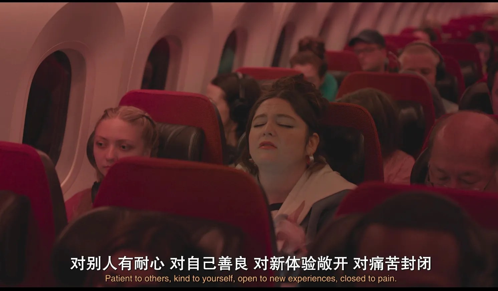
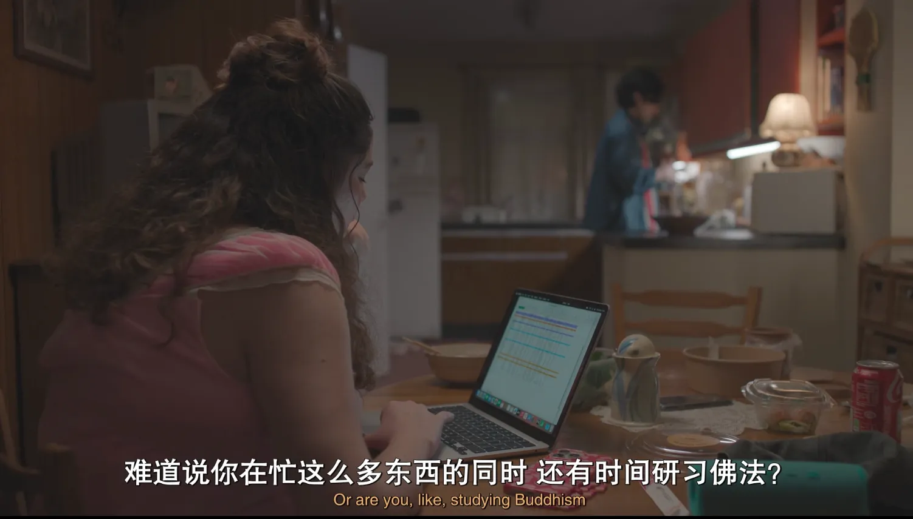
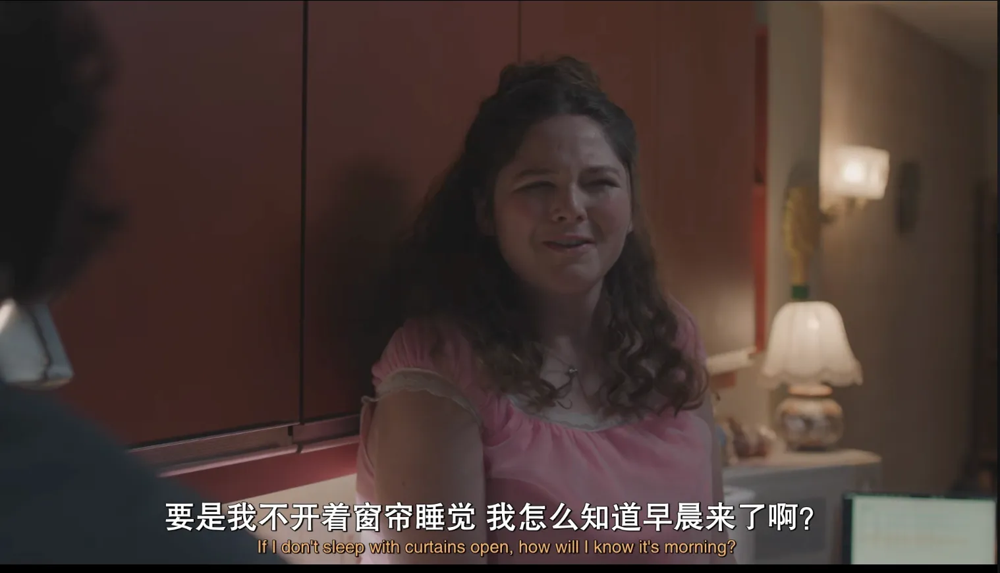
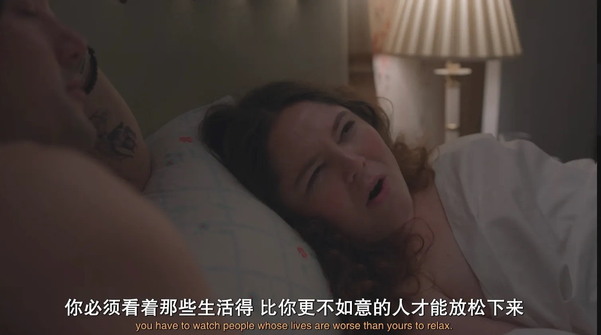
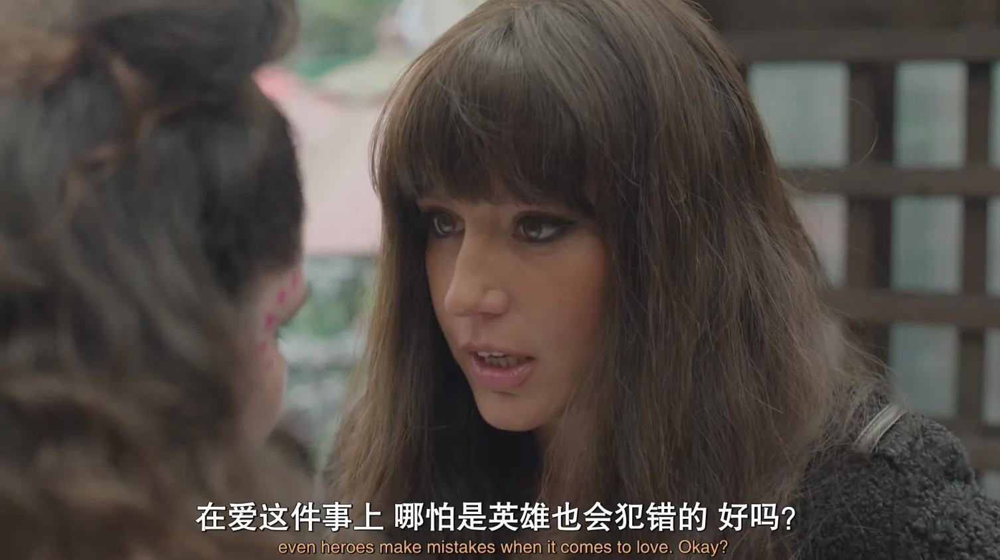
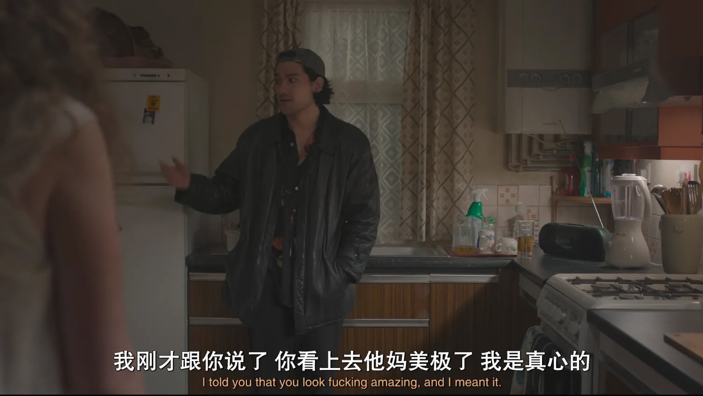
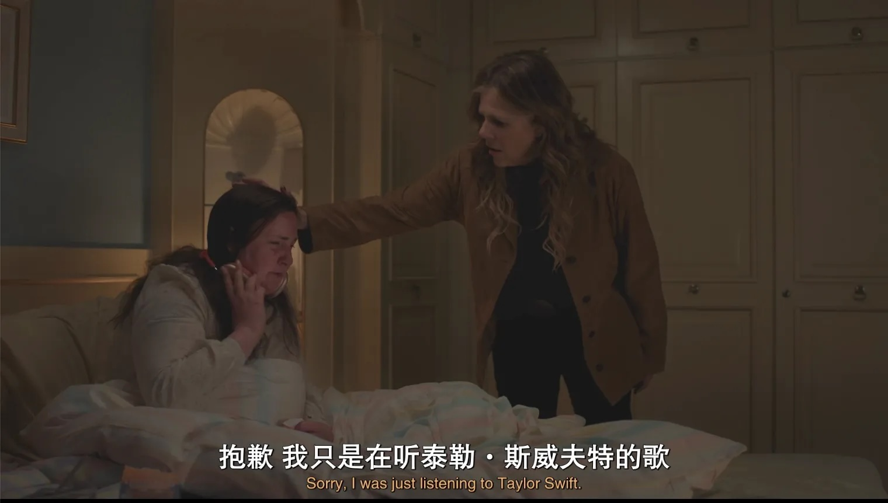
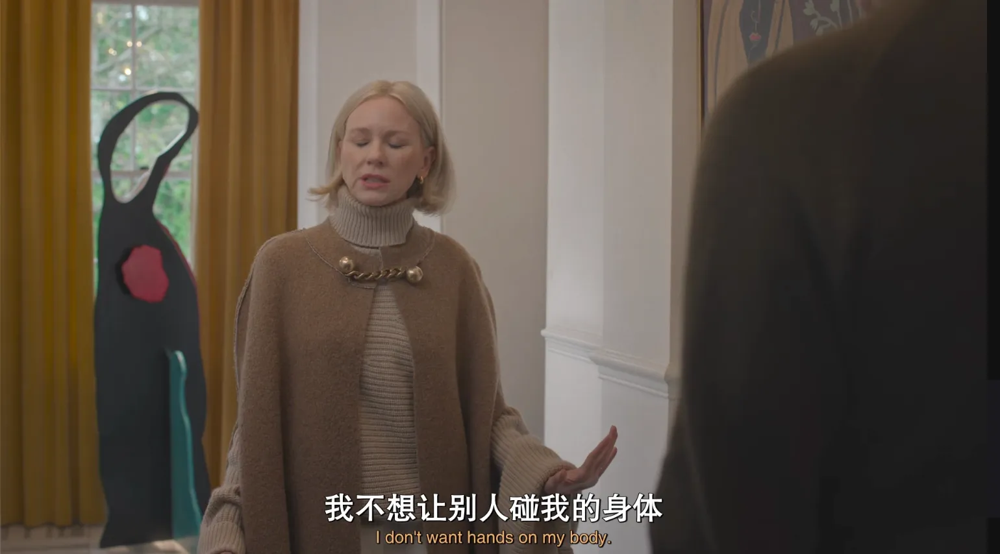

   ---
   title: "拿到Kindle的24h之后"
   date: 2026-09-03
   categories: ["随笔"]
   ---

## 游泳
今天终于去游泳，工作日的十一点健身房人很少，泳池安安静静。换气的时候可以听到其他人类打出规律的浪潮声音，一边重复简单的收翻蹬夹抬头换气一边任意发呆整理思绪。淋着一点点小雨走在回家的路上，不顾形象的带着干发帽和舒适布料的大衣，路过以前常常路过的花丛竟然暗淡的树叶上结了蜘蛛网。和自己呆在一起真是一件很幸福的事。

## 读《东京一年》
读这本书像是读一个爱读书爱旅行好朋友的日记。读到高更和梵高同居的故事，也顺带翻了他们更多的作品，一个心理健康的人到底有可能创造出传世之作吗，必须要对生活痛苦以至于这种感情强烈到格调自己的耳朵做出疯狂的事才有可能成为艺术家吗，让人不舒服才会更有冲击力吗。不禁让我想到《耻》，也许让人不舒服才能引人深思。

## pam跨过火焰
看到美版办公室第三季里的pam，她直接的说出自己的想法。“你们为什么不来我的画展，如果你要做我的男朋友你就必须今天晚上来，我还希望和你是好朋友我很想你”然后跨过火焰，是啊，自己的人生只属于自己，只有自己在乎，不要再等待了，跨过火焰，把愿望许给自己听。

## 人人都是时间的百万富翁（？
把做决定和做事情分开，当我决定了明天做什么，在做的时候就不要在花费精力做决定了。恰恰是这样我才拖延的。对这个世界有好奇心的我，觉得ai带给我最好的事情就是我可以再想问什么问题想查什么的时候就去查，可以问很蠢的问题，可以问很私密的问题，可以随时随地问问题。

## 写作
写作对于每个人来说都很艰苦，对于白人男性也是如此，亲爱的甜美的自负的疯狂的有天赋的受尽磨难的未来之星，你对写作的一心一意让我相信你就是为这件事存在的！

我知道写作是一种整理自己思绪和痛苦的很好的输出，我想也是一个具体又方便提高心气的小事。因为对人生和未来的迷茫，最近很痛苦甚至失去了睡眠。我想到如果我不断的把精力放在这样那样的小事，陷入情绪走不出来，就无法完成我人生中我想要进取的部分。我因为对自己有要求所以为过去虚度光阴而感到悔恨不已，因为无法走出这样的情绪所以放弃鼓励自己去坚持和用功，因为已经失去了平静和对生活的掌控感所以忘记自己的坚韧。当风浪来临的时候我之前所有的工具和希望，对自己的认可和信心，一点点微小的进步惊人都无影无踪。你的专注在哪里你的能量就在哪里你的显化就在哪里。

## too much这个电视剧真的不是给我拍的吗

